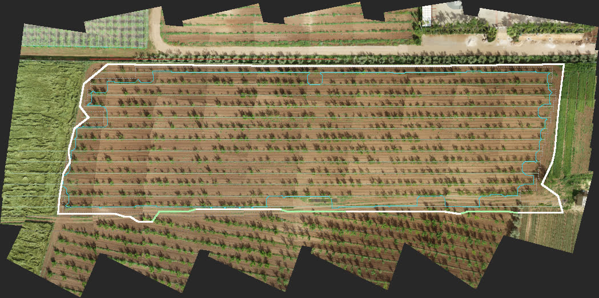

# Swardus Direct: automatic cultivated-block boundary (2026-10-28)

Experimental. The Field Twin infers where the cultivated block ends, from the reconciled crop rows, the trees
and the original photographs. Nobody draws it. The result is drawn on the twin with a confidence, clips the
pressure wash and the scouting regions to the block, keeps every observation outside it, can be corrected by
hand, and is never used as an operational (spray) limit until the operator accepts it.

Tested on the 71-photograph apricot flight. Pictures, the full report and the benchmark with its ablations:
[field-boundary-inference/](field-boundary-inference/) ([apricot-report.md](field-boundary-inference/apricot-report.md),
[apricot-benchmark.md](field-boundary-inference/apricot-benchmark.md)).

## Three boundaries, kept apart

| Boundary | What it is | Where |
|---|---|---|
| Cultivated block | The inferred planting, with its evidence, confidence and uncertainty | `twin.boundary.cultivated` (the bundle), `inferBoundary` in `src/lib/fieldTwin/boundary.ts` |
| Imagery coverage | The ground the photographs looked at: by any photograph, and by two or more | `imageCoverage` in `boundary.ts` (`twin.boundary.coverage`), `imageryHull` in `intelligence.ts` (the hull on the map) |
| Operational boundary | A boundary the operator accepted or corrected | The app's own state per twin (`swathwise:twin-boundary:<id>`), `operationalBoundary()` |

`operationalBoundary()` returns null for anything but an accepted or corrected ring, whatever the inferred
block's confidence. A spray plan cannot pick the inferred block up by accident: there is no code path from the
bundle's boundary to an operation.

## The method

Crop geometry decides what belongs to the block; the photographs decide where its edge lies.

1. **Reliable crop objects and rows** (`reliableRows`, `treesInCover`). Kept rows with at least 4 observed trees in
   2 photographs. Trees on a row whose surroundings (half a metre to two metres out from the crown) are mostly
   dense cover in the photographs are not crop objects of this field (they were strung into the wheat by the
   reconciliation) and are not used. A row is one connected line, grown outward from its largest run: a run of
   trees beyond a gap of more than 2.5 spacings is the row's own only if it sits on the row's line (within half a
   metre, or twice the row's own straightness, of the median across of the kept trees' nearest 30 m: no slope is
   extrapolated, a row here wanders half a metre over 200 m), does not drift across at its own angle (over a metre
   at more than 6°, slopes by Theil-Sen), does not spread over a metre when short, and, with photographs, stands
   beyond ground that is the field's own. A run that fails ends the row there; it and everything beyond are
   trimmed and reported with the rule that failed.
2. **Blocks of rows** (`rowComponents`). Rows are grouped by across: a gap of more than 2.5 pitches, spans along
   the rows that overlap by less than a fifth, or ground between two rows more than 1.5 pitches apart that is not
   the field's own (a track, a hedge, another crop) separate two blocks. Each block is scored against the others
   on this field, never on a universal number: rows with a neighbour at the pitch (35 %), trees per metre of row
   against the densest block (25 %), rows seen in enough photographs (20 %), share of the field's rows (20 %). The
   best block is the field; the others are reported as another block, never merged. Then an outer row more than
   15 % off the median pitch from its neighbour is excluded (on the apricot field that row was the hedge, 5.92 m
   out against a 4.90 m pitch).
3. **Row geometry.** The planting direction (the twin's, refined on the trees), the median row pitch, each row's
   first and last reliable tree, the outermost rows.
4. **Row-aligned boundary.** Each row's strip reaches half a pitch across; its ends reach a margin beyond the last
   tree. Without photographs the margin is half a plant spacing (the planter's own), every vertex marked
   `default`, and the result says so (`NO_PHOTOGRAPHS`).
5. **Concave baseline.** A morphological closing of the on-row trees (radius 0.6 pitch, 0.5 m raster), traced to a
   ring. Computed from reliable crop objects only, never from every vegetation detection. Reported beside the
   boundary with their overlap; never used as the boundary.
6. **Photographs.** The build (and `scripts/directGeoref/boundaryEvidence.ts`) samples every quarter-metre of
   ground from the photograph whose nadir is nearest (one measurement per cell, nothing stitched): cover share,
   brightness, saturation. `classifyEvidence` turns that into six classes: unseen, soil, canopy (a crown on the
   field's rows), cover (dense vegetation over 40 m² or more: wheat, a sward, a hedge), road (bright, low
   saturation), foreign (a crown off the field's rows, widened so a row of them reads as a band). Then from each
   row end and along each outer row, a probe walks outward and stops at the first ground that is not the field's
   own. What stopped it is recorded. A probe that meets nothing stops at a cap (3 pitches for row ends, 1.5 for
   sides) and says so; a row end that meets nothing is walked again as far as its neighbours' ends plus a pitch (a
   short row is usually missing trees, not shorter). On a side, an edge met by one probe bounds its neighbours
   within six plant spacings (a hedge between its crowns, another planting whose trees were only partly
   reconciled), and where most of a side met an edge the capped stretches between are bridged at that distance.
7. **No extrapolation.** A probe never walks into unseen ground: it stops with `coverage` support, and the
   block's share of unseen ground is a failure case if it is not nil (`BOUNDARY_EXTENDS_BEYOND_IMAGE_COVERAGE`).
8. **Uncertainty.** Each vertex: ± 0.5 m when the photographs showed the edge, the cap-to-edge gap when bridged,
   the whole margin when capped or at the end of the photographs, half the margin for a default. The area's
   plausible range is the sum over edges of length × uncertainty.
9. **Image coverage** (`imageCoverage`). The footprints rasterised at a metre: views per cell, the polygon seen
   by any photograph and the polygon seen by two or more, their areas and the mean views. Coverage, not the field.
10. **Stability.** The inference runs again under ten fixed variants of the rules (`STABILITY_VARIANTS`: the
    probe window 0.6 and 0.8, the pitch tolerance 12 and 18 %, the side reach 4 and 8 spacings, the default
    margin 0.45 and 0.55, the caps a sixth shorter and longer). How far each vertex moves under the worst variant
    is its stability; the area's range across the variants is reported.
11. **Confidence** (`confidenceOf` in the code: `CONFIDENCE_WEIGHTS`). Per vertex: row support (the row's trees
    against the median row's, 30 %), what the photographs showed (seen 1, bridged 0.5, coverage 0.25, cap 0.2,
    default 0; 25 %), views over the vertex (two or more is full; 20 %), agreement with the row-aligned and concave
    candidates (distance against two pitches; 15 %), stability (shift against the pitch; 10 %). Overall: the
    length-weighted 20th percentile of the edges, never the mean, so one unsupported side cannot hide behind three
    good ones; high at 0.75, medium at 0.5, low below. Anything but high asks for a review.
12. **Failure cases as data.** `failureModes` carries codes with details (`NO_PHOTOGRAPHS`,
    `INSUFFICIENT_ROW_SUPPORT`, `INSUFFICIENT_CROP_SUPPORT`, `MULTIPLE_COMPETING_BLOCKS`,
    `ADJACENT_CULTIVATED_BLOCK_DETECTED`, `LOW_IMAGE_EDGE_SUPPORT`, `BOUNDARY_EXTENDS_BEYOND_IMAGE_COVERAGE`,
    `SPARSE_OR_IRREGULAR_PLANTING`, `HIGH_PARAMETER_INSTABILITY`, `CAMERA_ALIGNMENT_UNCERTAIN`,
    `FOREIGN_GROUND_INSIDE`); `failures` carries the notes the operator reads. A code never means "no polygon": it
    says how to present the one there is.
13. **Vertices keep their support** through simplification: a straight side half seen and half bridged stays two
    edges, drawn differently.

Deterministic for the same inputs (checked by running twice). On the apricot twin: sampling 6.2 s for 71
photographs (the only step that reads pixels), classification 80 to 120 ms, inference 150 to 180 ms including the
ten-variant ensemble. Nothing here needs an orthomosaic. `inferBoundaryFromMeasures` is the one entry point the
build and the scripts share (rows judged on geometry, the ground classified, the trees in cover found, the rows
judged again, the ground classified once more, the inference).

## The apricot flight

Run: `npx vite-node scripts/directGeoref/boundaryEvidence.ts`, then `scripts/directGeoref/boundary.ts` (writes the
record into the twin's `twin.json`; `buildTwin.ts` carries it over on a rebuild), then `boundaryBench.ts` for the
metrics and the ablations (`--reference file.geojson` when a hand-drawn boundary exists).

White: edges the photographs showed. Pale green: bridged. The thin grey ring is the row-aligned baseline, the
cyan ring the concave baseline, red the excluded hedge row. (The picture is from the first run of the day; the
ring is the same to within two vertices.)

| | |
|---|---|
| Polygon | 34 vertices |
| Area | 1.361 ha, plausible range 1.303 to 1.419 ha |
| Confidence | 0.89, high (mean 0.90); the lowest edges (0.73 to 0.81) are the bridged stretch of the south side |
| Extent | 221.5 m along the rows, 69.1 m across |
| Rows used | 2 to 14 (13 rows); row 1 excluded (the hedge, 94 % of its line reads as hedge, planting or track); one block of rows |
| Edge length by support | photographs 87 %, bridged 13 %, cap 0 %, coverage 0 %, default 0 % |
| What stopped the probes | dense cover 15 (wheat, the green strip, the hedge), trees off the rows 15 (the hedge, the second planting) |
| Trees on the rows inside / outside | 903 / 0 |
| Trees not used | 29 standing in dense cover (the wheat), 6 trimmed from row ends (the second planting's rows crossing rows 2 and 14, off the line) |
| Trees off the rows inside | 6 (the trimmed ones near the south-west corner) |
| Ground inside by class | soil 79 %, canopy 20 %, foreign 0.5 %, cover 0.1 %, road 0 %, unseen 0 % |
| Image coverage | 2.80 ha by any photograph, 2.39 ha by two or more, 4.8 views on average |
| Stability | area 1.357 to 1.379 ha over the ten variants; vertices move 0.3 m (median), 4.5 m at most (the bridged side) |
| Failure codes | `ADJACENT_CULTIVATED_BLOCK_DETECTED` (102 trees of the hedge and the second planting outside, not included), `FOREIGN_GROUND_INSIDE` (the 6 trimmed trees) |
| Row-aligned baseline | 1.299 ha |
| Concave baseline | 1.130 ha, overlap 83 % |
| Processing | 6.2 s sampling, 110 ms classification, 170 ms inference with the ensemble |
| Evidence in the bundle | 525 × 261 cells at 0.5 m, 28 KB run-length encoded |

### Benchmark against the brief's targets

From [apricot-benchmark.md](field-boundary-inference/apricot-benchmark.md):

| Metric | Target | Measured |
|---|---|---|
| Polygon IoU, boundary distances, area bias against a hand-drawn reference | ≥ 0.93, ≤ 1 m mean, ≤ 2 m 95th, < 3 % | **no reference exists**: nobody has drawn one; `--reference` fills these in when one does |
| Crop inclusion recall | ≥ 98.5 % | 100 % of the 903 trees the engine counts as the field's; 96.6 % of all 936 objects with a used row's id (29 in the wheat and 6 of the second planting are judged not the field's, each with its reason) |
| Included-object precision | ≥ 99 % | 99.3 % |
| Neighbouring cultivated area included | < 1 % | 0.6 % of the block's ground reads as cover, road or trees off the rows |
| Repeatability | identical | two runs identical (ring, confidence, codes) |
| Boundary runtime, CPU, rows given | < 2 s | 0.15 to 0.18 s inference with the ensemble, 0.3 s for the whole pass |
| Without an orthomosaic | must | yes |

### Ablations: less confident before absurd

Each ablation changes the twin or the measurements and reruns the whole pass; "graceful" means the area changed
by at most 10 %, or the confidence fell by at least 0.05, or a failure code was raised. All eleven were graceful.

- **10 / 25 / 40 % of the trees removed** (by a hash of the id): the block holds within 5 % and the ends move
  6 m at the 95th percentile; confidence falls from 0.89 to 0.63, 0.60, 0.58 (medium) and
  `SPARSE_OR_IRREGULAR_PLANTING` is raised. The first version of the trimming rule retreated 22 m on some rows
  here (it measured a run against the row's median across, which a curving row cannot satisfy over 100 m); the
  outward-growing rule above came from this ablation.
- **A neighbouring block of 4 rows inserted 3 pitches away**: another block, separated by a gap of rows, none of
  its 128 trees inside, the boundary unchanged. **2 pitches away with a track painted between**: another block,
  separated by the ground between, none inside. **2 pitches away over the real ground (soil), and 1 pitch away**:
  merged (a planting two pitches away over bare soil is a missing row to this engine; nothing in the geometry or
  the ground can tell them apart), area +21 % and +17 %, confidence 0.51 and 0.63 with codes. Said here so it is
  not mistaken for a strength.
- **A hedge-like line of 21 off-row trees 3 m beyond the row ends**: none inside, the ends stop at it, the ring
  moves 0.15 m at the 95th percentile.
- **The last 3 trees of every row removed**: the end edge does not collapse to the last tree (the probes reach the
  same edge or cap 14.7 m out), area −1 %, confidence 0.76.
- **Image coverage cut 15 m before the last trees**: every end vertex is `coverage` support with margin 0,
  `BOUNDARY_EXTENDS_BEYOND_IMAGE_COVERAGE`, no vertex beyond the cut, confidence 0.73.
- **Every tree jittered up to 10 cm**: the ring moves 0.14 m on average, 0.5 m at most.

## In the app

- **Drawn** on the Field Twin at every detail stop: solid where the photographs showed the edge, dashed where
  bridged, dotted at a cap or the end of the photographs, grey dashed for a rows-only block. The ground fill is
  the block.
- **Clipped.** The pressure wash and the scouting regions (and so the Explore Findings regions) are clipped to
  the block when it is inferred or corrected. A rows-only block (older bundles, synthetic fields) does not clip:
  it is a half-spacing guess. Observations outside the block are kept: every weed is still drawn and listed, the
  layer "Pressure beyond the boundary" paints the wash there too, and the legend counts the verified candidates
  outside.
- **Field boundary card** (left column): area, how it was inferred, the share of edges by support, the
  confidence line (high: "inferred"; medium: "review the boundary", pointing at the dashed and dotted edges; low:
  check the edges before relying on it), the engine's notes, and the buttons Adjust (drag corners, drag an edge's
  midpoint handle to add one, double-click a corner to remove it), Done, Cancel, Reset to inferred, Accept for
  operations, Withdraw acceptance. The state is remembered per twin in the browser.
- **Boundary evidence** (Full, Diagnostics): the six classes over the ground, to see why an edge is where it is.
- **Dev API**: `window.__fieldTwin.boundary()` (the inferred record, the correction, the operational state).
- **The builder** (docs/features/field-twin-builder.md) runs the same sampling and inference on every twin it
  builds, so a twin built in the browser carries its boundary, confidence and codes.

Tests: `src/test/fieldTwinBoundary.test.ts` (classes, encoding, inference with and without photographs, the
cap, unseen ground, bridging, trimming, blocks of rows by gap and by ground, coverage polygons, confidence and
stability, failure codes, the record with and without the new fields, the operational guard, clipping).

## Not done

- A hand-drawn reference boundary for the overlap metrics. The Adjust tool draws one; the benchmark takes it as
  GeoJSON. Optional, Yunus's call.
- The operator's correction lives in the browser only, not in the account.
- One field. The rules carry one field's numbers (cover share 0.6, 40 m², the road thresholds); a grassed
  orchard would read as cover everywhere and needs the canopy-versus-sward mask the planting layout also needs.
- A planting two pitches away over bare soil merges with the field (see the ablations). A rule on the planting's
  own regularity (every row position filled on one side of the gap, none in it) could separate them; not built.
- The corridor minimum-cost refinement of the brief is not built: the probes stop at the first non-field window,
  which on this field is the same decision; a field whose edge is a gradual change (a verge, a sward) would want
  the cost path.
