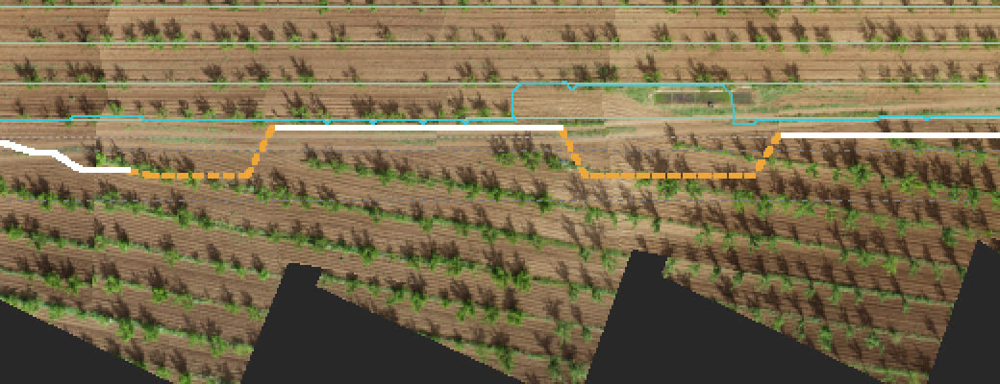
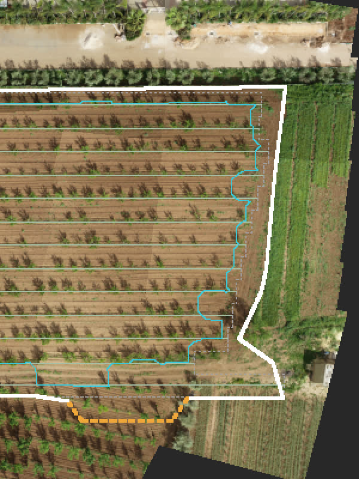

# Swardus Direct: automatic cultivated-block boundary (2026-10-28)

Experimental. The Field Twin now infers where the cultivated block ends, from the reconciled crop rows, the
trees and the original photographs. Nobody draws it. The result is drawn on the twin, clips the pressure wash
and the scouting regions to the block, keeps every observation outside it, can be corrected by hand, and is
never used as an operational (spray) limit until the operator accepts it.

Tested on the 71-photograph apricot flight. Pictures and the full report: [field-boundary-inference/](field-boundary-inference/).

## Three boundaries, kept apart

| Boundary | What it is | Where |
|---|---|---|
| Cultivated block | The inferred planting, with its evidence and uncertainty | `twin.boundary.cultivated` (the bundle), `inferBoundary` in `src/lib/fieldTwin/boundary.ts` |
| Imagery coverage | The ground the photographs looked at | `imageryHull` in `intelligence.ts`, the hull on the map |
| Operational boundary | A boundary the operator accepted or corrected | The app's own state per twin (`swathwise:twin-boundary:<id>`), `operationalBoundary()` |

`operationalBoundary()` returns null for anything but an accepted or corrected ring. A spray plan cannot pick
the inferred block up by accident: there is no code path from the bundle's boundary to an operation.

## The method

1. **Reliable crop objects and rows** (`reliableRows`, `treesInCover`). Kept rows with at least 4 observed trees in
   2 photographs. Trees on a row whose surroundings (half a metre to two metres out from the crown) are mostly
   dense cover in the photographs are not crop objects of this field (they were strung into the wheat by the
   reconciliation) and are not used. A row is one connected line: trees at either end beyond a gap of more than
   2.5 spacings count as the row's end only if they sit on its line; a run drifting across is another planting's
   row crossing it and is trimmed. An outer row more than 15 % off the median pitch from its neighbour is excluded
   (on the apricot field that row was the hedge, 5.92 m out against a 4.90 m pitch).
2. **Row geometry.** The planting direction (the twin's, refined on the trees), the median row pitch, each row's
   first and last reliable tree, the outermost rows.
3. **Row-aligned boundary.** Each row's strip reaches half a pitch across; its ends reach a margin beyond the last
   tree. Without photographs the margin is half a plant spacing (the planter's own), every vertex marked
   `default`, and the result says so.
4. **Concave baseline.** A morphological closing of the on-row trees (radius 0.6 pitch, 0.5 m raster), traced to a
   ring. Computed from reliable crop objects only, never from every vegetation detection. Reported beside the
   boundary with their overlap; never used as the boundary.
5. **Photographs.** `scripts/directGeoref/boundaryEvidence.ts` samples every quarter-metre of ground from the
   photograph whose nadir is nearest (one measurement per cell, nothing stitched): cover share, brightness,
   saturation. `classifyEvidence` (shared with the app and the tests) turns that into six classes: unseen, soil,
   canopy (a crown on the field's rows), cover (dense vegetation over 40 m² or more: wheat, a sward, a hedge),
   road (bright, low saturation), foreign (a crown off the field's rows, widened so a row of them reads as a
   band). Then from each row end and along each outer row, a probe walks outward and stops at the first ground
   that is not the field's own. What stopped it is recorded. A probe that meets nothing stops at a cap (3 pitches
   for row ends, 1.5 for sides) and says so; a row end that meets nothing is walked again as far as its
   neighbours' ends plus a pitch (a short row is usually missing trees, not shorter). On a side, an edge met by
   one probe bounds its neighbours within six plant spacings (a hedge between its crowns, another planting whose
   trees were only partly reconciled), and where most of a side met an edge the capped stretches between are
   bridged at that distance.
6. **No extrapolation.** A probe never walks into unseen ground: it stops with `coverage` support, and the
   block's share of unseen ground is a failure case if it is not nil.
7. **Uncertainty.** Each vertex: ± 0.5 m when the photographs showed the edge, the cap-to-edge gap when bridged,
   the whole margin when capped or at the end of the photographs, half the margin for a default. The area's
   plausible range is the sum over edges of length × uncertainty.
8. **Vertices keep their support** through simplification: a straight side half seen and half bridged stays two
   edges, drawn differently.

Deterministic for the same inputs. On the apricot twin: sampling 6.2 s for 71 photographs (the only step that
reads pixels), classification 130 ms, inference 120 ms. Nothing here needs an orthomosaic.

## The apricot flight

Run: `npx vite-node scripts/directGeoref/boundaryEvidence.ts` then `npx vite-node scripts/directGeoref/boundary.ts`
(writes the record into the twin's `twin.json`; `buildTwin.ts` carries it over on a rebuild).

White: edges the photographs showed. Pale green: bridged. The thin grey ring is the row-aligned baseline, the
cyan ring the concave baseline, red the excluded hedge row.

| | |
|---|---|
| Polygon | 36 vertices |
| Area | 1.358 ha, plausible range 1.295 to 1.421 ha |
| Extent | 221.5 m along the rows, 69.1 m across |
| Rows used | 2 to 14 (13 rows); row 1 excluded (the hedge, 94 % of its line reads as hedge, planting or track) |
| Edges by support | photographs 88 %, bridged 13 %, cap 0 %, coverage 0 %, default 0 % |
| What stopped the probes | dense cover 14 (wheat, the green strip, the hedge), trees off the rows 14 (the hedge, the second planting) |
| Trees on the rows inside / outside | 902 / 0 |
| Trees not used | 29 standing in dense cover (the wheat), 7 trimmed from row ends (the second planting's rows crossing) |
| Ground inside by class | soil 79 %, canopy 20 %, foreign 1 %, cover 0 %, road 0 %, unseen 0 % |
| Row-aligned baseline | 1.299 ha |
| Concave baseline | 1.130 ha, overlap 83 % |
| Processing | 6.2 s sampling, 130 ms classification, 120 ms inference |
| Evidence in the bundle | 525 × 261 cells at 0.5 m, 28 KB run-length encoded |

### Diagnosis against the photographs

- **Unsupported extensions.** Before the tree-reliability rules the boundary ran 25 m into the wheat on rows 9 to
  14: the reconciliation had strung "trees" along the wheat edge, and the row ends trusted them. Those trees'
  surroundings read as cover, so they are now left out, and the row ends sit at the wheat's grass strip. The
  five trees of another planting crossing row 14's line at an angle (2.6 m apart, drifting across) pulled its
  west end 16 m out; they are trimmed as off the line. Remaining: none seen.
- **Missing crop areas.** No tree on the used rows stands outside. The headland at the east end (10 to 15 m of
  tilled soil between the last trees and the green strip) is inside, as it should be.
- **Neighbouring-field inclusion.** 0 % of the block reads as dense cover. The hedge row along the track was a
  candidate row of the twin; the pitch rule excludes it and the side probes stop at the hedge. The second
  planting along the south, at a different row angle, bounds the block through the trees of it the twin
  reconciled (foreign) and, where it reconciled none, by bridging: 20 side probes, ± 5 m. That is the one stretch
  the operator should check (the pale green edge).

### Failure cases reported by the engine

See [apricot-report.md](field-boundary-inference/apricot-report.md). In short: 20 bridged side probes; 29 trees in
cover not used; 7 trees trimmed from rows 2, 6 and 14; 103 trees off the rows outside (the hedge and the second
planting, not included); row 1 excluded; the concave baseline overlaps 83 %.

## In the app

- **Drawn** on the Field Twin at every detail stop: solid where the photographs showed the edge, dashed where
  bridged, dotted at a cap or the end of the photographs, grey dashed for a rows-only block. The ground fill is
  the block.
- **Clipped.** The pressure wash and the scouting regions (and so the Explore Findings regions) are clipped to
  the block when it is inferred or corrected. A rows-only block (older bundles, synthetic fields) does not clip:
  it is a half-spacing guess. Observations outside the block are kept: every weed is still drawn and listed, the
  layer "Pressure beyond the boundary" paints the wash there too, and the legend counts the verified candidates
  outside.
- **Field boundary card** (left column): area, how it was inferred, the share of edges by support, the engine's
  notes, and the buttons Adjust (drag corners, drag an edge's midpoint handle to add one, double-click a corner
  to remove it), Done, Cancel, Reset to inferred, Accept for operations, Withdraw acceptance. The state is
  remembered per twin in the browser.
- **Boundary evidence** (Full, Diagnostics): the six classes over the ground, to see why an edge is where it is.
- **Dev API**: `window.__fieldTwin.boundary()`.

Tests: `src/test/fieldTwinBoundary.test.ts` (classes, encoding, inference with and without photographs, the
cap, unseen ground, bridging, trimming, the record, the operational guard, clipping).

## Not done

- The boundary is inferred by the build scripts; a twin built in the app will run the same code once the
  builder is in the app.
- The operator's correction lives in the browser only, not in the account.
- One field. The rules carry one field's numbers (cover share 0.6, 40 m², the road thresholds); a grassed
  orchard would read as cover everywhere and needs the canopy-versus-sward mask the planting layout also needs.
