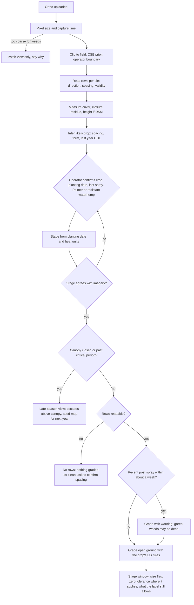

# From an uploaded ortho to a grade: what we can work out, and what we must ask

Research of 2026-10-22, US corn, soybean, wheat and cotton. The question: an operator uploads an orthomosaic of one of
these crops; what can we infer for ourselves, how sure can we be, what must we ask, and what should the app do when it is
unsure. The crop files ([corn](corn.md), [soybean](soybean.md), [wheat](wheat.md), [cotton](cotton.md)) and
[row-reading-approaches.md](row-reading-approaches.md) hold the detail; this file draws it together. Our own estimates
are labelled, and every inference below comes with the way it fails.

The short answer: from the imagery alone we can measure rows, cover, closure and residue, and narrow the crop; we cannot
know the planting date, what was sprayed, or which weed species are present, and those decide the grade more than cover
does. US guidance acts on crop stage, weed height and, for Palmer amaranth, any presence at all; none of the four crops
has a US cover-percentage action point except a fall total-cover rating for Kentucky wheat. So the operator's answers are
not a nuisance to minimise at any cost: three of them carry most of the weight.

## 1. What the imagery gives with no input at all

**The pixel size and the flight.** The ortho's georeferencing gives its pixel size; the photographs' EXIF gives the date
and time. Pixel size decides what is possible before anything else: individual weeds of action size (about 10 cm) need
about 1 to 2.5 cm a pixel by the four-pixel rule, patches can be mapped at 5 cm or coarser ([Peña et al. 2015, Sensors](https://pmc.ncbi.nlm.nih.gov/articles/PMC4435221/);
[Huang et al. 2018, Weed Technology](https://ars.usda.gov/ARSUserFiles/60663500/Publications/Huang/2018/Huang%20et%20al_2018_WT_32-2-6.pdf)).
The common US mapping cameras give about 1 cm a pixel per 37 m of height ([DJI Phantom 4 RTK](https://www.dji.com/phantom-4-rtk/info)),
and the 400 ft ceiling ([14 CFR 107.51](https://www.law.cornell.edu/cfr/text/14/107.51)) makes about 3.3 cm the coarsest
legal RGB, so an ortho coarser than that was flown with a waiver, resampled, or from another camera. The capture time
gives the sun's elevation, and shadow length is plant height divided by the tangent of it: 1.7 times the height at 30
degrees, 0.6 times at 60 (our arithmetic); a nadir camera with an 84 degree field of view puts the bright antisolar hotspot
inside frames when the sun is above about 55 degrees (our estimate), so midday flights trade shadow for hotspot.

**Rows: direction, spacing, and whether there are any.** A tiled profile reader with an FFT start finds row direction and
spacing in continuous-row crops without training (corn F1 0.995 over 6.1 ha; cotton 0.99 to 1.00; wheat 0.66 to 0.82 at
2 cm; [row-reading-approaches.md](row-reading-approaches.md)). It also tells us when there are no readable rows: broadcast
soybean (part of the 14 to 20% of drilled or broadcast soybean in Ohio and North Dakota, [USDA NASS 2025](https://esmis.nal.usda.gov/sites/default/release-files/795725/cropan26.txt)),
drilled rows at 5 cm a pixel, or a closed canopy.

**Canopy cover.** Green cover by a Canopeo-style colour rule classified 90% of pixels correctly against reference tools
in corn and grasses ([Patrignani and Ochsner 2015, Agronomy Journal](https://doi.org/10.2134/agronj15.0150)),
with known bias on green or residue backgrounds. A 2026 Ohio method takes weed cover in soybean as total green cover minus
soybean cover, and weed cover tracked weed density and biomass at r 0.78, best at V1 to V2 ([Dias Mendonça et al. 2026](https://acsess.onlinelibrary.wiley.com/doi/full/10.1002/ael2.70073), snippet).

**Row closure.** Closure in the agronomic sense is about 95% light interception ([ASA abstract](https://scisoc.confex.com/scisoc/2008am/webprogramschedule/Paper42983.html));
the Wisconsin soybean work used 90% green cover as its closure point ([UW-Madison](https://wiscweeds.info/images/Update%20Series%20Articles/WWRUS%20Article%208_Canopy%20Closure.pdf)).
No paper gives a drone RGB rule for declaring closure, or measures how the periodic row signal fades as cover rises. Our
proposed signal: cover above about 90% together with a falling row peak against background (our estimate, to be
measured on our own fields).

**What lies between the rows.** Bare soil, crop residue or green. Residue cover from drone RGB at about 1 cm: unsupervised
clustering reached R² 0.79 against line transects in Indiana corn and soybean fields, best in no-till and in winter
([Azimi and Jung 2024, Remote Sensing](https://mdpi-res.com/d_attachment/remotesensing/remotesensing-16-01135/article_deploy/remotesensing-16-01135.pdf));
deep-learning residue classifiers fell from 96% on their own field to under 58% on new ones (snippet). Residue and soil
differ mainly in brightness in the visible; the diagnostic cellulose absorption is near 2,100 nm, out of reach of RGB and
of drone multispectral cameras ([Daughtry, USDA-ARS](https://avng.jpl.nasa.gov/pub/docs/workshops/01_docs/2001Daughtry_web.pdf)).
The NRCS classes are conventional under 15% residue, reduced 15 to 30%, conservation 30% or more after planting
([Purdue AY-269](https://agry.purdue.edu/ext/pubs/AY-269-W.pdf)).

**Height, when a DSM comes with the ortho.** Crop height from one photogrammetric flight is possible while soil is still
visible between rows, by interpolating a ground surface from the bare pixels (poppy R² 0.97; wheat against lidar R² 0.97,
RMSE 7.7 cm; [Madec et al. 2017](https://www.frontiersin.org/articles/10.3389/fpls.2017.02002/full)). It fails once the
canopy closes. Accuracy varies by crop: cotton R² 0.89 to 0.96 at about 3 cm RMSE, corn R² 0.77 to 0.79 with a 7 to 9 cm
underestimate, soybean R² about 0.5 at 45.7 m (sources in the crop files).

**The field and its edges.** USDA's Crop Sequence Boundaries give national field polygons from an eight-year Cropland
Data Layer stack, the 2018 to 2025 release out on 27 March 2026 ([USDA NASS CSB](https://www.nass.usda.gov/Research_and_Science/Crop-Sequence-Boundaries/index.php)),
a ready prior for clipping an ortho to its field. Headlands show as rows running across the main direction along the
edges, point rows as rows ending on an angled edge (our estimate); no US source on headland widths or point-row frequency
was found, and the residue survey method itself tells people to stay out of end rows (AY-269).

## 2. What that lets us infer, and how sure we can be

**Which crop.** Row spacing narrows it but does not decide it:

| Measured spacing | Likely crops | Confidence |
|---|---|---|
| under about 25 cm, or no rows with full cover | wheat, drilled soybean | wheat vs drilled soybean not separable by spacing |
| about 38 cm (15 in) | soybean (most), rare corn, planter-sown wheat, narrow cotton | soybean likely in IN, OH, MO, IL |
| 51 to 56 cm (20 to 22 in) | soybean or corn, northern states | ambiguous |
| about 76 cm (30 in) | corn, soybean, some cotton | ambiguous between corn and soybean |
| 97 to 102 cm (38 to 40 in), or 2x1 skips | cotton, southern bedded soybean | cotton likely outside Arkansas |

Our synthesis of the crop files and NASS 2025; the bands are ours. Spacing alone cannot separate 30 in corn from 30 in
soybean, the commonest pair in the Corn Belt.

Two further signals help. The plant's form: corn has long strap leaves and a whorl, soybean trifoliate leaves, cotton
palmate leaves, wheat fine tillers; a classifier on texture and shape could separate them early to mid season. No
single-date drone benchmark separating these four US crops was found; texture features lifted single-date drone crop
classification from 73% to 95% in one study ([ISPRS Archives 2018](https://isprs-archives.copernicus.org/articles/XLII-3/1023/2018/), snippet)
and to 86% per field in another at 5 cm ([Böhler et al. 2018, Remote Sensing](https://www.mdpi.com/2072-4292/10/8/1282)),
so this is plausible but untested by us. And the rotation prior: the USDA Cropland Data Layer is 10 m from 2024 and
30 m before ([NASS CDL FAQ](https://www.nass.usda.gov/Research_and_Science/Cropland/sarsfaqs2.php)), released in late
January or late February for the previous year (the 2025 layer on 27 February 2026), so for a current-season flight only
last year's crop is available. Producer's accuracy is "generally 85% to 95%" for major crops, but low for a state's minor
crops (2023: Iowa winter wheat 36.8%, Texas soybean 48.8%; [NASS metadata, Iowa](https://www.nass.usda.gov/Research_and_Science/Cropland/metadata/metadata_ia23.htm),
[Texas](https://www.nass.usda.gov/Research_and_Science/Cropland/metadata/metadata_tx23.htm)). Corn and soybean alternate
most often in the central US ([Plourde et al. 2013](https://www.sciencedirect.com/science/article/abs/pii/S0167880912004379), abstract),
so in Iowa, Illinois and Indiana last year's crop flipped is a reasonable guess to show, not to use unconfirmed (our
estimate). In the South the CDL is too weak on soybean and wheat to lean on.

*How we would know we are wrong:* spacing outside every band, form and spacing disagreeing, or the CDL prior
contradicting both. *What to do:* never grade on a guessed crop; pre-fill the guess and ask for one tap.

**Growth stage.** Cover alone cannot give a stage: it depends on row width, population and planting date (soybean closes
about 15 days earlier in 15 in than 30 in rows, [Iowa State](https://crops.extension.iastate.edu/encyclopedia/row-spacing-soybean)).
No published table turns cover into V stages for corn or soybean, or Feekes for wheat. Height helps in cotton and wheat,
little in soybean, and cannot stage seedling corn because its error is the size of a V2 to V4 plant. Labels and
extension advice go by stage, and NDSU says plainly not to time herbicides by height or row closure
([NDSU A1172](https://www.ndsu.edu/agriculture/sites/default/files/2023-01/a1172.pdf)). The defensible route is planting
date plus heat units (corn one leaf per 82 GDD after 120 to emerge, [Purdue](https://agry.purdue.edu/ext/corn/news/timeless/vstageprediction.html);
cotton by DD60, [UGA C1244](https://fieldreport.caes.uga.edu/publications/C1244/cotton-growth-monitoring-and-pgr-management/);
soybean about 5 days per early V stage, NDSU), with the imagery as a check: early cover with visible separate plants
says early V; closure says past about V10 in 30 in corn, past about R1 to R3 in soybean, past jointing in wheat.

*How we would know we are wrong:* the stage from the date disagrees with what the imagery shows (a "V4" field already
closed, a "V12" field with bare alleys). *What to do:* show both and ask; a replant or a wrong date is likelier than a
miracle.

**Whether the canopy has closed.** Measurable, as above, and the most important single thing for the grade: after
closure there is no visible ground between rows to divide by, and the US critical periods are over or nearly so.
*What to do when closed:* say the field is past the stage where cover between rows can be read, and offer the late-season
products instead (escapes above the canopy, which nadir RGB does see; seed-rain estimates from canopy volume, r 0.87 for
Palmer, [Kutugata et al. 2021](https://www.cambridge.org/core/journals/weed-science/article/seed-rain-potential-in-lateseason-weed-escapes-can-be-estimated-using-remote-sensing/DE00CA1864C2FB75E15E8CB8CA89493F)).

**Tillage and residue.** Inferable at about 1 cm with moderate confidence (R² 0.79 at best, poor transfer). It matters
for the grade in two ways: residue changes the background a vegetation mask works against, and no-till usually means a
burndown and a residual programme. *What to do when unsure:* treat the between-row ground as "residue or soil, unknown"
and keep the mask conservative.

**A recent spray.** Symptoms have known timing: contact products (paraquat, PPO inhibitors) water-soak and brown leaves
within hours to days, glufosinate burns within hours and yellows the whole plant in 4 to 5 days, glyphosate shows nothing
for 3 to 5 days and then yellows and browns slowly, HPPD products bleach leaves white
([K-State C715](https://bookstore.ksre.ksu.edu/pubs/C715.pdf); [University of Wisconsin key](https://corn.aae.wisc.edu/Management/pdfs/L022_HerbicideMOASymptoms.pdf)).
So many brown or white weed-shaped objects beside a green crop suggest a recent post spray (our inference, unvalidated;
the only remote-sensing herbicide-injury paper found was hyperspectral, [Huang et al. 2016](https://doi.org/10.1016/j.biosystemseng.2016.06.013)).
The opposite case is the dangerous one: a field sprayed with glyphosate three days ago looks untreated, and every weed in
it is dead but still green. Imagery cannot rule out a recent spray.

## 3. What we cannot infer, and the shortest question set

Ordered by how much each answer changes the grade:

1. **What is the crop?** (One tap, pre-filled from spacing, form and last year's CDL.) Everything hangs on it: which
   critical period, which height window, which row reader settings, which escape species matter. Ask only when the
   inference is not confident, but always show it for confirmation; a silent wrong crop is the worst failure.
2. **When was it planted?** (A date.) With heat units, this gives the growth stage, which decides whether the field is
   inside its critical period, whether a post pass is still on the label (dicamba cut-offs by date and stage, Enlist to
   R2, Liberty to R1 in soybean; 2,4-D before jointing in wheat), and whether "act now" or "too late, map for next year"
   is the right message. Nothing in the imagery replaces it.
3. **What was last sprayed, and when?** (Pre-emergence residual or post; date.) A field inside a residual's protection is
   graded on its escapes; a field sprayed post in the last week may show green weeds that are already dead; a field with
   no residual and weeds past 4 in is past the cheap fix. Imagery cannot tell a three-day-old glyphosate pass from no pass.
4. **Is Palmer amaranth, or herbicide-resistant waterhemp, known in this field?** (Yes, no, not sure.) RGB at our
   resolution cannot tell Palmer from waterhemp or from other pigweeds, and US guidance for Palmer is zero tolerance:
   under it, any pigweed-like object is an action, whatever the cover. The answer changes the trigger, not just the class.

Two more only when the imagery leaves them open: **confirm the row spacing** when the reader is unsure or the field has
skips (it is the denominator of the grade), and, for cotton and wheat, **irrigated or dryland**, which changes closure
timing and expected cover.

Everything else (row direction, cover, closure, residue, boundary, headlands, height when there is a DSM) we measure and
show, without asking.

## 4. How each inference fails, and what the app does

| Inference | How it goes wrong | How we would see it | What the app does |
|---|---|---|---|
| Rows and spacing | canopy closed; drilled rows at coarse pixels; dense weeds pull lines; curved rows; skips read as gaps | weak periodic peak; tiles disagree on direction; spacing outside the crop's known values | report "no readable rows" and grade nothing as clean; show the spacing it read for confirmation |
| Crop | 30 in corn vs soybean; drilled wheat vs drilled soybean; CDL wrong for minor crops | form and spacing disagree; CDL contradicts both | pre-fill, ask one tap, never grade unconfirmed |
| Stage | wrong planting date; replant; stress delays | date-based stage disagrees with closure or plant size in the imagery | show both, ask |
| Closure | partial closure, uneven stands | cover near 90% with a fading row peak | grade the open parts, mark closed parts not assessable |
| Residue vs soil vs weed | straw under a pixel; green cover crop vs weeds in spring; weathered residue | residue estimate unstable across the field | keep the mask conservative; say the background is uncertain |
| Recent spray | glyphosate too slow to show; contact burn misread as bare | brown or bleached weed objects; operator's spray date | use the answer to question 3; if a post spray is within about a week, warn that green weeds may already be dead |
| Weed species | RGB cannot name them at 1 to 5 cm | not observable | ask question 4; never name a species from the map |
| Imagery fit | pixels too coarse; hotspot; wind blur; ortho seams over uniform canopy | pixel size from georeferencing; capture time; stitching artefacts | refuse tasks the pixel size cannot support (individual weeds over about 2.5 cm) and say why |

## 5. The flow from upload to grade

In prose: read the ortho's pixel size and capture time and decide which tasks it can support at all; clip to the field
(Crop Sequence Boundaries as a prior, the operator's boundary over it); read rows tile by tile; measure cover, closure,
residue and, with a DSM, height; infer the likely crop from spacing, form and last year's CDL; ask the operator to confirm
the crop and give the planting date and last spray, and whether Palmer or resistant waterhemp is present; compute the
stage from the date and heat units and check it against the imagery; then branch. If the canopy is closed or the stage is
past the critical period, the cover grade is not available and the app offers the late-season view (escapes, next year's
map). If no rows can be read, the app says so and grades nothing as weed-free. Otherwise it grades the open ground between
rows with the crop's US rules (stage window, size flag, zero-tolerance trigger where it applies), and says what the
operator can still do on the label.

## What this changes about thresholds

The grade today takes its action points from the Turkish ministry (wide-row 10% cover, orchards 10 or 15%) and from a
German study for cereals; see [summary.md](summary.md). The flow above assumes they are replaced by the US currencies the
crop files document: crop stage windows, weed height, density per row length where it exists, zero tolerance for Palmer
amaranth, and, for wheat only, Kentucky's fall total-cover rating. Cover between rows remains what we measure best; the
research says it should inform the operator, with the stage window and the species answer deciding when to act.
