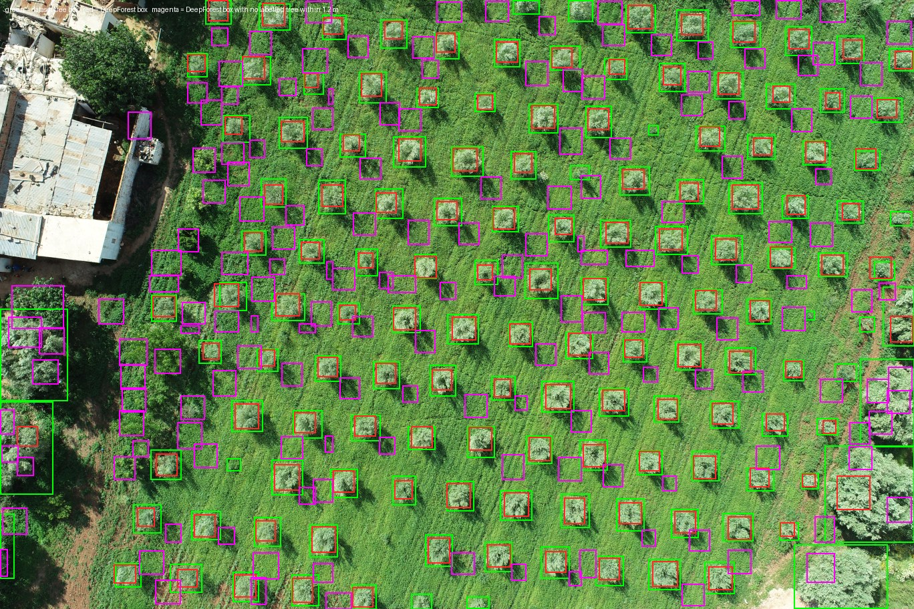
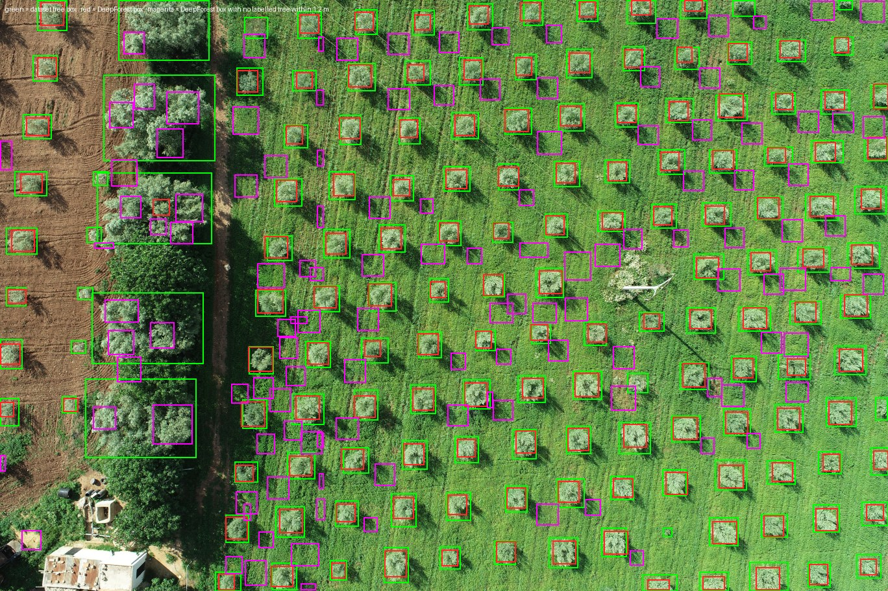
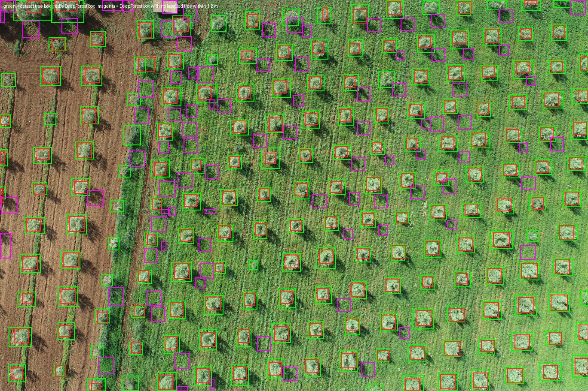
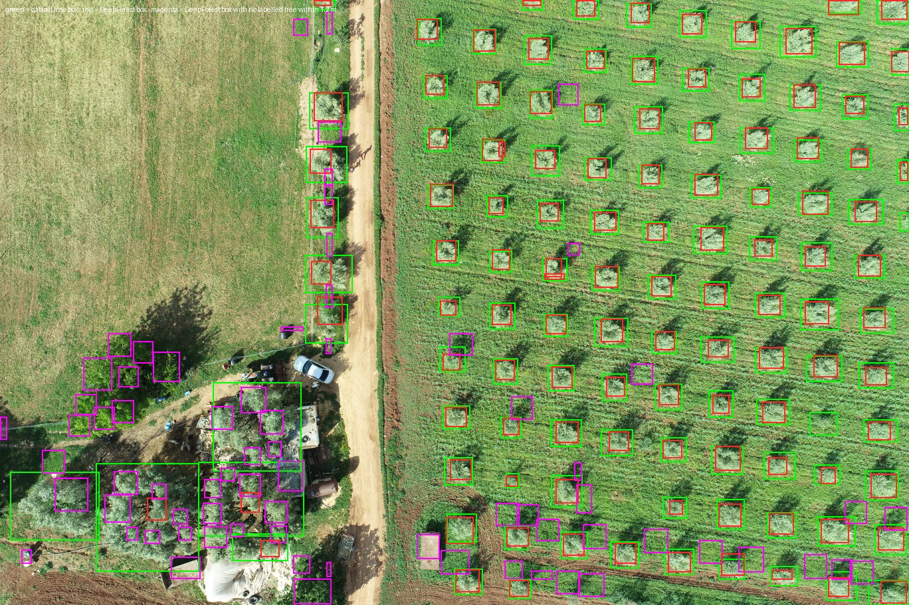
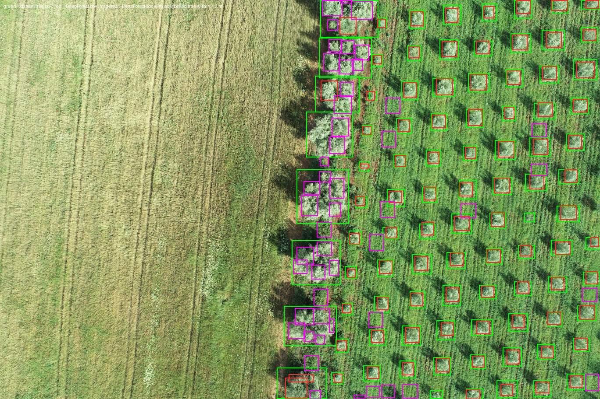
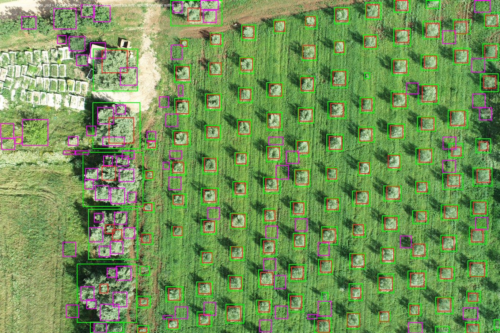

# DeepForest pretrained tree-crown detector on the public olive orchard (OliveTreeCrownsDb)

Date: 2026-10-19. Research trial only. Nothing under `src/`, `scripts/`, `research/` or `evaluation/` was touched, nothing was committed; the six frames and their boxes were read as untrusted data (scripts kept in `D:\swardus-research\deepforest\scripts\`, Python run with `-I`, nothing run from inside the data folder).

## Question

The planting-layout fitter put 3 of 820 labelled olive trees on a crown on these six frames (`D:\swardus-research\olive\report.md`): on a grassed olive orchard the sward is greener than the silver-green canopy, so the lattice phase-locked onto the grass between trees. Does the pretrained DeepForest tree model (`weecology/deepforest-tree`, RetinaNet, one class "Tree", trained on NEON forest canopies at 10 cm/px; see `D:\swardus-research\deepforest\report.md` for setup, versions and licence) find these crowns instead, scored against the dataset's own tree boxes? Does it merge or split them, and where does it box things that are not labelled trees?

## Data

- Six DJI Phantom 4 RTK frames of OliveTreeCrownsDb (Mendeley Data, DOI 10.17632/xym8rd2srf.3, CC BY 4.0; Meknes, Morocco): DJI_0365, 0369, 0380, 0386, 0395, 0407, each 5472 x 3648 px, 1.67 cm/px from the XMP altitude (61 m above take-off, 8.8 mm lens). Frames in `D:\swardus-research\olive\data\raw_jpg\`, one Pascal-VOC `.xml` per frame in `raw_xml\`.
- Ground truth: the dataset's tree boxes, 820 in all (143, 155, 186, 115, 94, 127 per frame; the XML and YOLO counts agree). Median labelled box side (mean of width and height) **2.68 m**, min 0.91 m, max 10.86 m. There are no labels for anything other than olive trees: the farmyards (DJI_0365, 0386, 0407), the roadside hedges and garden trees, the cereal field (DJI_0395) and the ploughed bare soil (DJI_0369, 0380) carry no boxes. Large old olives along a hedge (DJI_0395) and at farmyard edges (DJI_0386, 0369, 0407) are labelled with boxes of 4-11 m side: 35 of the 820 boxes exceed 4 m, 71 are under 2 m.

## Method

- `scripts\run_trial_olive.py` is a copy of `scripts\run_trial.py` adapted to take `--frame-dir`, `--xml-dir` and frame stems (the original has its frame folder and point-label file as constants). Everything else is the same: box-filter downsample by the factor, `predict_tile(image=..., patch_size=400, patch_overlap=0.25)`, default `score_thresh 0.1` and `nms_thresh 0.05`, boxes multiplied back to original pixels, per-frame CSV, 1/4-scale overlay PNG, `timings.csv`, `scores.csv`, `run_info.json`. Factors 3, 5 and 6 give **5.01, 8.35 and 10.02 cm/px** (1824x1216, 1094x730, 912x608 px).
- Scoring, per frame and factor, with 1.2 m = 71.9 px:
  - a labelled tree is **found** if a predicted box contains its box centre or a predicted box centre lies within 1.2 m of it;
  - **boxes on a labelled tree** = predicted boxes containing at least one labelled centre; **merges** = boxes containing two or more; **trees with 2+ boxes** = labelled trees matched by more than one box (splits);
  - **false boxes** = predicted boxes that contain no labelled centre and whose centre is more than 1.2 m from every labelled centre. These are split three ways in `scripts\analyze_olive.py`: centre inside some labelled box (a fragment of a labelled crown, almost always one of the > 4 m trees), outside every labelled box but within 4.5 m of a labelled centre (inside the orchard block: the sward between trees, or an unlabelled tree at the block edge), and farther than 4.5 m from any labelled centre (outside the block: farmyards, hedges, roadside, cereal field);
  - **IoU** between each found tree and the best-overlapping box among those that matched it; the median is over those pairs;
  - median predicted box side (mean of width and height) against the median labelled side.
- Timing: wall time of `predict_tile` alone (frame load and resize excluded), CPU, 11 torch threads on 12 cores; peak RSS from psutil.

### Commands

```powershell
$env:HF_HOME='D:\swardus-research\deepforest\hf-cache'; $env:TMP='D:\swardus-research\tmp'; $env:TEMP='D:\swardus-research\tmp'
& D:\swardus-research\deepforest\venv\Scripts\python.exe -I D:\swardus-research\deepforest\scripts\run_trial_olive.py --factors 3 5 6 --frame-dir D:\swardus-research\olive\data\raw_jpg --xml-dir D:\swardus-research\olive\data\raw_xml --frames DJI_0365 DJI_0369 DJI_0380 DJI_0386 DJI_0395 DJI_0407 --out D:\swardus-research\deepforest\out-olive *> D:\swardus-research\deepforest\out-olive-run_log.txt
& D:\swardus-research\deepforest\venv\Scripts\python.exe -I D:\swardus-research\deepforest\scripts\analyze_olive.py --out D:\swardus-research\deepforest\out-olive --xml-dir D:\swardus-research\olive\data\raw_xml > D:\swardus-research\deepforest\out-olive\analysis.md
```

A smoke run (DJI_0365, factor 6) went to `out-olive-smoke\` and a re-timing of DJI_0380 and DJI_0365 at factor 3 to `out-olive-retime\`; both reproduce the main run's boxes and scores exactly. The log's only stderr line is a `torch.export` deprecation warning, which PowerShell wraps as `NativeCommandError`; the run exited 0.

## Results

### Pooled over the six frames (820 labelled trees)

| Factor | cm/px | Boxes | Trees found | Recall | Boxes on a labelled tree | Boxes holding 2+ trees | Trees with 2+ boxes | False boxes (no labelled tree within 1.2 m) | of which: fragment inside a labelled box / in the block (sward, <= 4.5 m) / outside the block (> 4.5 m) | Median predicted side | Median labelled side | Median IoU (matched pairs) | Pairs with IoU >= 0.5 |
|---|---|---|---|---|---|---|---|---|---|---|---|---|---|
| 3 | 5.01 | 2379 | 781 | **95.2 %** | 742 | 0 | 110 | 1472 | 382 / 922 / 168 | 1.30 m | 2.68 m | 0.48 | 44 % |
| 5 | 8.35 | 1344 | 752 | **91.7 %** | 747 | 0 | 4 | 588 | 118 / 418 / 52 | 2.13 m | 2.68 m | 0.58 | 81 % |
| 6 | 10.02 | 1048 | 722 | **88.0 %** | 722 | 0 | 2 | 324 | 57 / 217 / 50 | 2.20 m | 2.68 m | 0.59 | 82 % |

### Per frame

Columns: labelled trees; predicted boxes; trees found (recall); boxes on a labelled tree; boxes holding 2+ trees; trees with 2+ boxes; false boxes as total (fragment / in-block sward / outside block); median predicted side against median labelled side; median IoU of matched pairs (share >= 0.5); median box score; `predict_tile` seconds.

**Factor 3 (5.01 cm/px)**

| Frame | Trees | Boxes | Found | On a tree | 2+ trees | Trees w/ 2+ boxes | False (frag / sward / outside) | Pred side / label side | IoU median (>= 0.5) | Score | s |
|---|---|---|---|---|---|---|---|---|---|---|---|
| DJI_0365 | 143 | 532 | 129 (90.2 %) | 123 | 0 | 22 | 378 (49 / 284 / 45) | 1.28 / 2.76 m | 0.47 (33 %) | 0.30 | 9.5 |
| DJI_0369 | 155 | 451 | 149 (96.1 %) | 140 | 0 | 25 | 272 (65 / 194 / 13) | 1.28 / 2.67 m | 0.50 (50 %) | 0.34 | 9.5 |
| DJI_0380 | 186 | 390 | 176 (94.6 %) | 162 | 0 | 21 | 190 (12 / 173 / 5) | 1.25 / 2.58 m | 0.45 (32 %) | 0.35 | 52.5 (9.3 on re-run) |
| DJI_0386 | 115 | 353 | 113 (98.3 %) | 109 | 0 | 11 | 227 (69 / 113 / 45) | 1.25 / 2.70 m | 0.51 (54 %) | 0.30 | 11.1 |
| DJI_0395 | 94 | 229 | 90 (95.7 %) | 87 | 0 | 9 | 129 (70 / 57 / 2) | 1.40 / 2.58 m | 0.51 (53 %) | 0.37 | 11.2 |
| DJI_0407 | 127 | 424 | 124 (97.6 %) | 121 | 0 | 22 | 276 (117 / 101 / 58) | 1.33 / 2.84 m | 0.49 (47 %) | 0.34 | 10.4 |

**Factor 5 (8.35 cm/px)**

| Frame | Trees | Boxes | Found | On a tree | 2+ trees | Trees w/ 2+ boxes | False (frag / sward / outside) | Pred side / label side | IoU median (>= 0.5) | Score | s |
|---|---|---|---|---|---|---|---|---|---|---|---|
| DJI_0365 | 143 | 296 | 128 (89.5 %) | 127 | 0 | 0 | 168 (17 / 140 / 11) | 2.17 / 2.76 m | 0.58 (77 %) | 0.40 | 4.8 |
| DJI_0369 | 155 | 266 | 141 (91.0 %) | 141 | 0 | 0 | 125 (16 / 106 / 3) | 2.13 / 2.67 m | 0.60 (87 %) | 0.51 | 5.4 |
| DJI_0380 | 186 | 256 | 165 (88.7 %) | 163 | 0 | 0 | 91 (1 / 86 / 4) | 2.05 / 2.58 m | 0.57 (77 %) | 0.54 | 5.0 |
| DJI_0386 | 115 | 185 | 111 (96.5 %) | 110 | 0 | 2 | 72 (23 / 34 / 15) | 2.09 / 2.70 m | 0.57 (77 %) | 0.50 | 4.8 |
| DJI_0395 | 94 | 137 | 87 (92.6 %) | 87 | 0 | 1 | 49 (31 / 17 / 1) | 2.05 / 2.58 m | 0.59 (86 %) | 0.60 | 5.0 |
| DJI_0407 | 127 | 204 | 120 (94.5 %) | 119 | 0 | 1 | 83 (30 / 35 / 18) | 2.21 / 2.84 m | 0.60 (83 %) | 0.59 | 4.7 |

**Factor 6 (10.02 cm/px)**

| Frame | Trees | Boxes | Found | On a tree | 2+ trees | Trees w/ 2+ boxes | False (frag / sward / outside) | Pred side / label side | IoU median (>= 0.5) | Score | s |
|---|---|---|---|---|---|---|---|---|---|---|---|
| DJI_0365 | 143 | 227 | 121 (84.6 %) | 121 | 0 | 0 | 106 (8 / 88 / 10) | 2.30 / 2.76 m | 0.58 (81 %) | 0.44 | 2.3 |
| DJI_0369 | 155 | 202 | 134 (86.5 %) | 134 | 0 | 1 | 67 (8 / 57 / 2) | 2.25 / 2.67 m | 0.63 (87 %) | 0.54 | 2.4 |
| DJI_0380 | 186 | 205 | 156 (83.9 %) | 155 | 0 | 0 | 49 (0 / 45 / 4) | 2.10 / 2.58 m | 0.57 (78 %) | 0.53 | 2.4 |
| DJI_0386 | 115 | 150 | 108 (93.9 %) | 108 | 0 | 0 | 42 (16 / 10 / 16) | 2.10 / 2.70 m | 0.57 (75 %) | 0.52 | 2.4 |
| DJI_0395 | 94 | 102 | 85 (90.4 %) | 86 | 0 | 1 | 16 (10 / 4 / 2) | 2.05 / 2.58 m | 0.60 (87 %) | 0.61 | 2.5 |
| DJI_0407 | 127 | 162 | 118 (92.9 %) | 118 | 0 | 0 | 44 (15 / 13 / 16) | 2.25 / 2.84 m | 0.59 (86 %) | 0.62 | 2.4 |

### Runtime (CPU, 11 threads, `predict_tile` only)

| Factor | Input px | Seconds per frame (min / max over six frames) | Peak RSS |
|---|---|---|---|
| 3 | 1824 x 1216 | 9.5 / 11.2 (DJI_0380 took 52.5 s in the batch and 9.3 s when re-run alone; the other re-run frame, DJI_0365, gave 9.2 s against 9.5 s; the boxes were identical, so the 52.5 s is a one-off stall of the machine, not of the frame) | 1.17 GB |
| 5 | 1094 x 730 | 4.7 / 5.4 | 1.17 GB |
| 6 | 912 x 608 | 2.3 / 2.5 | 1.17 GB |

Model load from the local HF cache: 1.1 s. Resizing a 5472 x 3648 JPEG adds about 0.5 s per frame outside the timed window.

### What the missed trees are

| Factor | Missed | Median labelled side of missed trees (IQR) | under 2 m | over 4 m | Median labelled side of found trees |
|---|---|---|---|---|---|
| 3 | 39 | 2.24 m (1.76-4.42) | 16 | 11 | 2.70 m |
| 5 | 68 | 2.00 m (1.62-2.65) | 34 | 15 | 2.71 m |
| 6 | 98 | 2.07 m (1.75-2.52) | 42 | 14 | 2.73 m |

Half the misses are the smallest crowns in the frame (under 2 m, against 71 such boxes in all); another 14-15 are the oversized old olives (over 4 m, 35 in all), where DeepForest boxes parts of the crown and none of the parts reaches the labelled centre.

### False boxes: size and score against boxes on a tree (pooled)

| Factor | Boxes on a labelled tree: median side (IQR) | median score (IQR) | False boxes: median side (IQR) | median score (IQR) |
|---|---|---|---|---|
| 3 | 1.83 m (1.60-2.05) | 0.63 (0.52-0.71) | 1.10 m (0.85-1.38) | 0.27 (0.22-0.33) |
| 5 | 2.05 m (1.84-2.25) | 0.68 (0.59-0.74) | 2.17 m (1.75-2.34) | 0.25 (0.19-0.35) |
| 6 | 2.15 m (1.95-2.35) | 0.62 (0.52-0.68) | 2.61 m (2.05-2.81) | 0.24 (0.17-0.37) |

Score-threshold sweep (pooled; the run used 0.1):

| Factor | thr 0.1 | 0.2 | 0.3 | 0.4 | 0.5 | 0.6 |
|---|---|---|---|---|---|---|
| 3 | 781 found (95.2 %), 1472 false | 763 (93.0 %), 1187 | 730 (89.0 %), 540 | 674 (82.2 %), 165 | 591 (72.1 %), 38 | 433 (52.8 %), 5 |
| 5 | 752 (91.7 %), 588 | 746 (91.0 %), 419 | 724 (88.3 %), 216 | 694 (84.6 %), 107 | 640 (78.0 %), 30 | 543 (66.2 %), 2 |
| 6 | 722 (88.0 %), 324 | 690 (84.1 %), 193 | 665 (81.1 %), 122 | 641 (78.2 %), 65 | 566 (69.0 %), 10 | 409 (49.9 %), 3 |

No threshold produces a merge (boxes holding two labelled trees stay at 0 throughout).

## Overlays (factor 5, 1/4 scale)

Green = dataset tree box, red = DeepForest box, magenta = DeepForest box with no labelled tree within 1.2 m. Factor 3 and 6 overlays for every frame are in `out-olive\<frame>_ds<factor>_overlay.png`.








Where the false boxes sit, frame by frame, from the overlays and the three-way split above (factor 5):

- **DJI_0365** (168 false: 17 fragments, 140 in the block, 11 outside). The block is the grassiest of the six and gets the most sward boxes: tufts of taller, darker grass in the lanes between rows and on the shadow side of crowns. The farmyard at the left edge (house, hedge of shrubs and trees) and the roadside trees at the lower right are real trees with no labels; they take the 11 outside boxes and some of the block boxes near the edge.
- **DJI_0369** (125: 16 / 106 / 3). The ploughed bare soil on the left is clean apart from the large labelled olives along it, which are split into parts (the 16 fragments). The 106 block boxes are on the grass between crowns.
- **DJI_0380** (91: 1 / 86 / 4). The 26 trees on ploughed soil are all boxed and the bare soil carries no false boxes; the 86 block boxes are in the grassed part, densest along the weedy strip where the ploughing stops.
- **DJI_0386** (72: 23 / 34 / 15). The farmyard at the bottom left has three labelled large trees, split into parts (the 23 fragments), and unlabelled garden trees and shrubs that take the 15 outside boxes. The lower part of the block, where the grass is patchy and weedy, holds most of the 34 sward boxes; the upper, evenly grassed part of the block is nearly clean.
- **DJI_0395** (49: 31 / 17 / 1). The cereal field on the left half carries one box, at its edge; the rest of the field is empty. The hedge of old olives between field and block is labelled with 4-11 m boxes and DeepForest boxes each as two to four crowns (the 31 fragments). The block gets 17 sward boxes.
- **DJI_0407** (83: 30 / 35 / 18). The garden with raised beds and small trees at the top left, and the roadside shrubs on the left, are unlabelled and take the 18 outside boxes; the column of large labelled olives along the track is fragmented (30); 35 on the sward.

## Reading

**Does it find silver-green olive crowns on a grass sward?** Yes. At factor 5 it finds 752 of 820 labelled trees (91.7 %), at factor 3 781 (95.2 %), at factor 6 722 (88.0 %), against 3 of 820 for the planting-layout fitter on the same frames. The boxes sit on the crowns: at factors 5 and 6 the median IoU with the dataset's box is 0.58-0.59 and 81-82 % of matched pairs reach 0.5. Crowns on bare ploughed soil (DJI_0369, DJI_0380) and on the sward are found alike, so the grass that defeated the excess-green mask does not matter to this model. The misses are the smallest crowns (half of them under 2 m) and the oversized hedge olives.

**Does it merge or split?** It never merges: no box holds two labelled trees at any factor or threshold (rows are 5.2-5.5 m apart, crowns 2.7 m). It splits in two ways. At factor 3 (5 cm/px) it boxes half-crowns: median predicted side 1.30 m against 2.68 m labelled, 110 trees with two or more boxes, 382 fragment boxes inside labelled crowns, median IoU 0.48. That resolution is too fine for 2.7 m crowns with this model, the opposite of the finding on our own 2 m trees at 1 cm/px, where factor 5 (5 cm/px) was right. At factors 5 and 6 the splits all but vanish (4 and 2 trees with two boxes) and the box side settles at 2.13-2.20 m, about 20 % tighter than the dataset's boxes, which are drawn generously round the crown. The large old olives (4-11 m side) are split into two to four crowns at every factor; the model's prior is one crown of 2-3 m.

**Where are the false boxes?** At factor 5, 588 of 1344 boxes have no labelled tree within 1.2 m. 118 are parts of the oversized labelled olives, not false trees. 52 lie outside the orchard block and are, by eye, real trees and shrubs that the dataset does not label: farmyard hedges and garden trees in DJI_0365, 0386 and 0407, roadside trees. The cereal field (DJI_0395) and the ploughed soil (DJI_0369, 0380) are clean: one box on the cereal edge, none on the bare soil. The remaining 418 are on the sward inside the block, on tufts of taller or darker grass and on the shadow side of crowns; these are the real false trees, the same "green roundish blob" behaviour seen on our own frames. They are weak: median score 0.25 (IQR 0.19-0.35) against 0.68 (0.59-0.74) for boxes on a crown. A score gate of 0.3 at factor 5 keeps 724 trees (88.3 %) with 216 false boxes; 0.4 keeps 694 (84.6 %) with 107; 0.5 keeps 640 (78.0 %) with 30. The sward boxes are also crown-sized (median 2.17 m at factor 5), so size alone does not separate them; score does most of the work, and the rest would have to come from the row lattice, which the fitter already finds on these frames to within 0.4 m and 7 degrees.

**Runtime.** 4.7-5.4 s per frame at factor 5 on CPU, 2.3-2.5 s at factor 6, 9.5-11.2 s at factor 3; 1.17 GB peak. One stall to 52.5 s on DJI_0380 at factor 3 did not reproduce.

**What this does and does not say.** On this orchard DeepForest at 8.35 cm/px is a working crown proposer where the rule-based fitter was not: 92 % of the trees boxed, none merged, 44 % of its boxes not on a labelled tree before any gate and about half of those removable by a 0.3 score gate at a cost of 28 trees. It does not know rows, planting spacing or olive from poplar; the farmyard and hedge trees it boxes are trees. Not measured here: the tiled sets, the other 40 frames, any frame at a season other than the one flown, and precision in the strict sense (the dataset's labels stop at the orchard block, so boxes outside it cannot be scored).

## Files

- Scripts: `D:\swardus-research\deepforest\scripts\run_trial_olive.py`, `D:\swardus-research\deepforest\scripts\analyze_olive.py`.
- Outputs: `D:\swardus-research\deepforest\out-olive\` (18 box CSVs with per-box match flags, 18 match CSVs with per-tree IoU, 18 overlay PNGs, `timings.csv`, `scores.csv`, `run_info.json`, `analysis.json`, `analysis.md`); the run log `D:\swardus-research\deepforest\out-olive-run_log.txt`; smoke and re-timing runs in `out-olive-smoke\` and `out-olive-retime\`.
- Copy of this report: `C:\Users\Yunus\Desktop\acrespraydevelopmentg\acresprayai\docs\research\deepforest-olive-trial.md` with the six factor-5 overlays as JPEGs (665-693 KB each) in `docs\research\deepforest-olive-trial\` (uncommitted).
